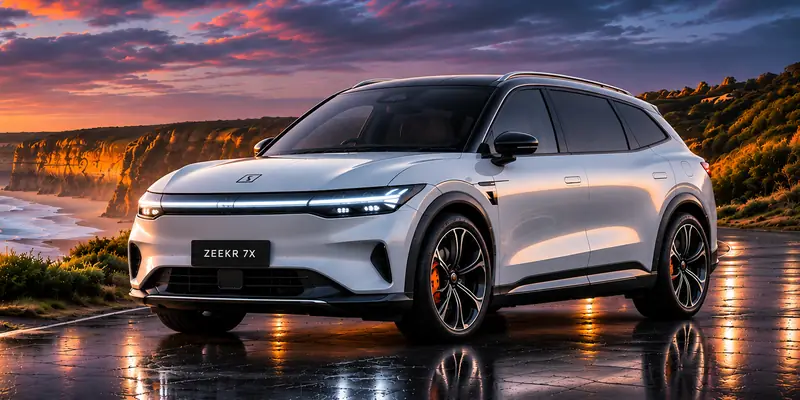
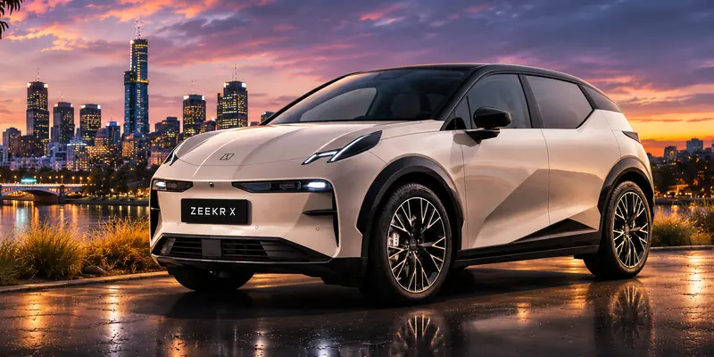
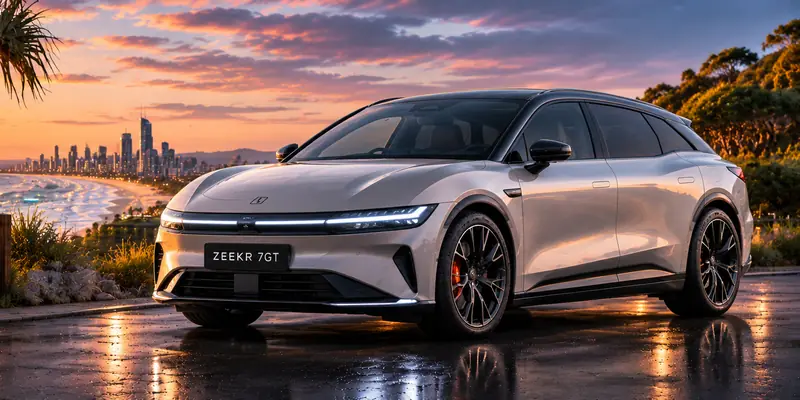
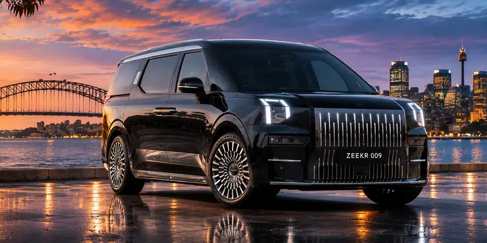

    Owner-run &middot; Australia
    <h1 class="hero-title">Master your Zeekr.</h1>
    

        An owner-run guide to buying and living with a Zeekr in Australia, with sources on every page.
    

    

        <a href="buying/" class="btn-hero btn-hero-primary">Thinking of buying</a>
        <a href="ownership/first-30-days/" class="btn-hero btn-hero-secondary">I've just got my car</a>
    

## Start here

    

        {{ card_icon("tag") }}
        <h3>Buying</h3>
        
Prices, on-road costs, finance and where to buy, with the 2027 7X changeover explained.

        <a class="go" href="buying/">Buying</a>
    

    

        {{ card_icon("key-round") }}
        <h3>I've just got my car</h3>
        
Numbers to save, paperwork to keep, home charging and the settings owners ask about first.

        <a class="go" href="ownership/first-30-days/">I've just got my car</a>
    

    

        {{ card_icon("plug-zap") }}
        <h3>Charging</h3>
        
Home setup, public networks and planning a road trip.

        <a class="go" href="guides/charging/public-networks/">Charging</a>
    

    

        {{ card_icon("users") }}
        <h3>Community</h3>
        
Who we are, and how to join a drive near you.

        <a class="go" href="community/">Community</a>
    

New to EVs? [Knowledge](knowledge/index.md) explains batteries, charging and range in plain English.

## The lineup at a glance

    

        <picture>
            <source type="image/avif" srcset="assets/images/models/7x-card.avif 800w, assets/images/models/7x-card-1200.avif 1200w" sizes="(max-width: 44.984375em) 100vw, 25vw">
            
        </picture>
        <h3>Zeekr 7X</h3>
        
Mid-size SUV on an 800V system. Figures are MY25/MY26.

        

            
800VSystem

            
615kmWLTP (Long Range, MY25/MY26)

            
$57.9kFrom + ORC

        

        <a class="go" href="models/7x/overview/">Zeekr 7X</a>
    

    

        <picture>
            <source type="image/avif" srcset="assets/images/models/x-card.avif 800w, assets/images/models/x-card-1200.avif 1200w" sizes="(max-width: 44.984375em) 100vw, 25vw">
            
        </picture>
        <h3>Zeekr X</h3>
        
Compact SUV. Figures are MY26.

        

            
250kWPower (RWD)

            
415kmWLTP (AWD)

            
$48.9kDrive-away (RWD)

        

        <a class="go" href="models/x/overview/">Zeekr X</a>
    

    

        Not yet on sale
        <picture>
            <source type="image/avif" srcset="assets/images/models/7gt-card.avif 800w, assets/images/models/7gt-card-1200.avif 1200w" sizes="(max-width: 44.984375em) 100vw, 25vw">
            
        </picture>
        <h3>Zeekr 7GT</h3>
        
Electric wagon. Confirmed for Australia, no price yet. Figures are as reported.

        

            
670kmWLTP (Long Range, reported)

            
Q1 2027First deliveries (expected)

        

        <a class="go" href="models/7gt/overview/">Zeekr 7GT</a>
    

    

        <picture>
            <source type="image/avif" srcset="assets/images/models/009-card.avif 800w, assets/images/models/009-card-1200.avif 1200w" sizes="(max-width: 44.984375em) 100vw, 25vw">
            
        </picture>
        <h3>Zeekr 009</h3>
        
People mover with six or seven seats.

        

            
116kWhBattery (FWD)

            
604kmWLTP (FWD)

            
$115.9kFrom + ORC

        

        <a class="go" href="models/009/overview/">Zeekr 009</a>
    

*Last checked: 8 November 2026.* 7X: price [^1], range and 800V system [^4][^1]. X: price, power and range [^2]. 009: price, battery and range [^3]. 7GT: confirmed for Australia but not yet on sale [^5]; range and delivery timing as reported [^6]. The updated 2027 7X (MY27) keeps the same prices and has up to 627 km WLTP on the Long Range [^1]; see [Which 7X do I have?](models/7x/which-7x.md).

## Sources

[^1]: CarExpert, "2027 Zeekr 7X update: more power, same price", <https://www.carexpert.com.au/car-news/2027-zeekr-7x-update-more-power-same-price>, accessed 8 November 2026.
[^2]: CarExpert, "2026 Zeekr X price and specs updated: EV gets massive price cuts", <https://www.carexpert.com.au/car-news/2026-zeekr-x-price-and-specs-updated-ev-gets-massive-price-cuts-1>, accessed 8 November 2026.
[^3]: CarExpert, "2026 Zeekr 009: Luxury EV people mover gets more affordable", <https://www.carexpert.com.au/car-news/2026-zeekr-009-luxury-ev-people-mover-gets-more-affordable>, accessed 8 November 2026.
[^4]: Zeekr Australia, "Zeekr 7X", <https://www.zeekrlife.com/en-au/models/zeekr-7x>, accessed 8 November 2026.
[^5]: Zeekr Australia, "Zeekr 7GT", <https://www.zeekrlife.com/en-au/models/zeekr-7gt>, accessed 8 November 2026.
[^6]: The Driven, "Zeekr 7GT confirmed for 2026 launch in Australia with 670 km range and 3.1 second sprint", <https://thedriven.io/2026/09/19/zeekr-7gt-confirmed-for-2026-launch-australia-with-670km-range-and-3-1-second-sprint/>, accessed 8 November 2026.
