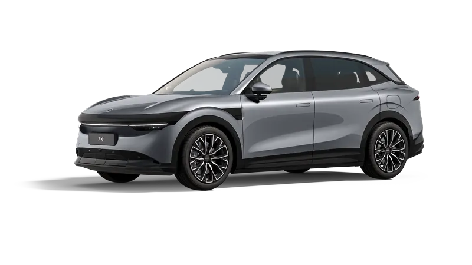
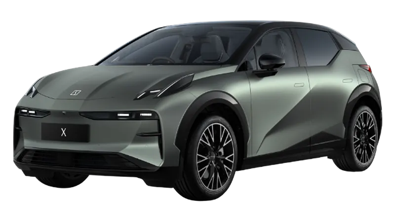
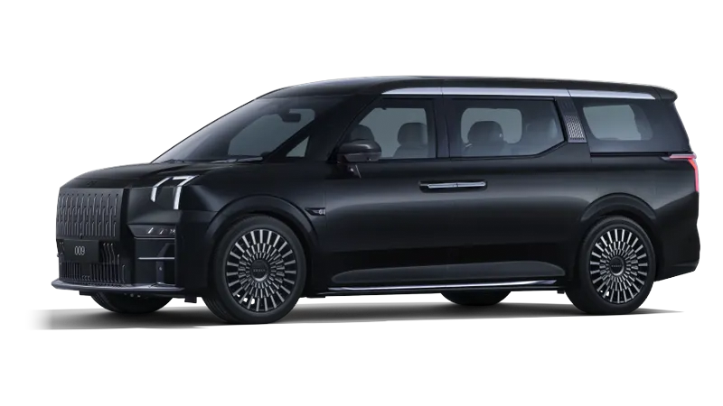

# Zeekr Models

*Last checked: 8 November 2026.*

Three Zeekr models are on sale in Australia: the 7X, the X and the 009.

!!! info "2027 7X (MY27)"
    The updated 2027 7X (MY27) delivers from December 2026. Figures on this page are for the MY25/MY26 car unless marked. See [Which 7X do I have?](7x/which-7x.md).

## Current lineup

    

        
        <h3>Zeekr 7X</h3>
        
<strong>Mid-size SUV.</strong> Five seats, 800V charging, from $57,900 before on-road costs. RWD, Long Range RWD and Performance AWD.

        
<a href="7x/2025/specifications/">Specifications</a> &middot; <a href="7x/2025/pricing/">Pricing</a>

        <a class="go" href="7x/overview/">7X Overview</a>
    

    

        
        <h3>Zeekr X</h3>
        
<strong>Compact SUV.</strong> Five seats, from $48,900 drive-away for the MY26 RWD. RWD and AWD.

        
<a href="x/2025/specifications/">Specifications</a> &middot; <a href="x/2025/pricing/">Pricing</a>

        <a class="go" href="x/overview/">X Overview</a>
    

    

        
        <h3>Zeekr 009</h3>
        
<strong>People mover.</strong> Six or seven seats, from $115,900 before on-road costs. FWD and AWD.

        
<a href="009/specifications/">Specifications</a> &middot; <a href="009/pricing/">Pricing</a>

        <a class="go" href="009/overview/">009 Overview</a>
    

Images: Zeekr

Prices: 7X [1], X [2], 009 [3].

## Which one fits?

- **Compact and easy to park:** the X.
- **Five seats with a bigger boot (539 L) and 2,000 kg braked towing:** the 7X [4][5].
- **Six or seven seats:** the 009.

For more help, see [Choosing a Model](../getting-started/choosing-model.md) and the [model comparison table](../comparisons/model-comparison-table.md).

## Costs and incentives

- The 009 is priced above the 2026-27 Luxury Car Tax threshold for fuel-efficient vehicles ($91,661), so LCT applies to it; the 7X and X are below it [6]. See the [finance guide](../buying/finance.md) for novated leasing.
- The Victorian and NSW EV purchase rebates have ended [8]. For your state, see the [state resources](../resources/index.md).

## Warranty and service

- All three models: 5 years / unlimited km vehicle warranty (private use), 8 years / 160,000 km battery warranty, 5 years roadside assistance [7].
- Zeekr lists 17 sales sites in Australia; fewer offer service. See [Where to Buy](../buying/dealers.md).
- Service intervals differ by model and model year. See the service schedule under each model.

## Sources

1. CarExpert, "2027 Zeekr 7X update: more power, same price", <https://www.carexpert.com.au/car-news/2027-zeekr-7x-update-more-power-same-price>, accessed 8 November 2026.
2. CarExpert, "2026 Zeekr X price and specs updated: EV gets massive price cuts", <https://www.carexpert.com.au/car-news/2026-zeekr-x-price-and-specs-updated-ev-gets-massive-price-cuts-1>, accessed 8 November 2026.
3. CarExpert, "2026 Zeekr 009: Luxury EV people mover gets more affordable", <https://www.carexpert.com.au/car-news/2026-zeekr-009-luxury-ev-people-mover-gets-more-affordable>, accessed 8 November 2026.
4. CarExpert, "2026 Zeekr 7X price and specs", <https://www.carexpert.com.au/car-news/2026-zeekr-7x-price-and-specs>, accessed 8 November 2026.
5. The Driven, "Zeekr 7X electric SUV approved in Australia, offers 2-tonne towing", <https://thedriven.io/2025/08/29/zeekr-7x-electric-suv-approved-in-australia-offers-2-tonne-towing/>, accessed 8 November 2026.
6. Cars24, "Luxury Car Tax thresholds increase for Australia in FY2026-27", <https://www.cars24.com.au/car-news/luxury-car-tax-thresholds-australia-2026-27/>, accessed 8 November 2026.
7. Zeekr Intelligent Technology Australia, "Australian Warranty Policy", <https://www.datocms-assets.com/130529/1770683613-australian-warranty-policy.pdf>, accessed 8 November 2026.
8. RACV, "Electric vehicle rebates, discounts and incentives in Australia", <https://www.racv.com.au/royalauto/transport/electric-vehicles/electric-car-discounts-government-incentives-australia.html>, accessed 8 November 2026.
